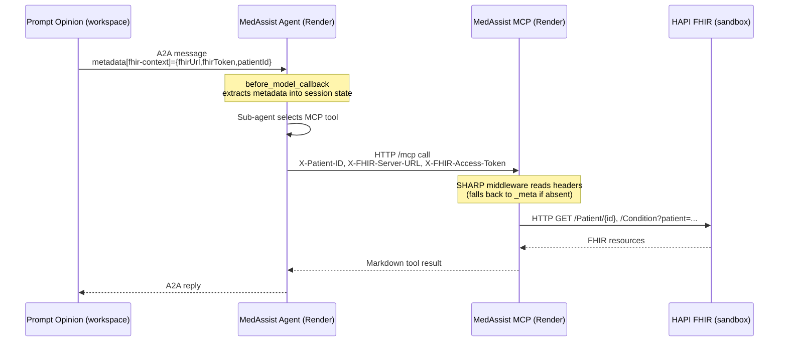
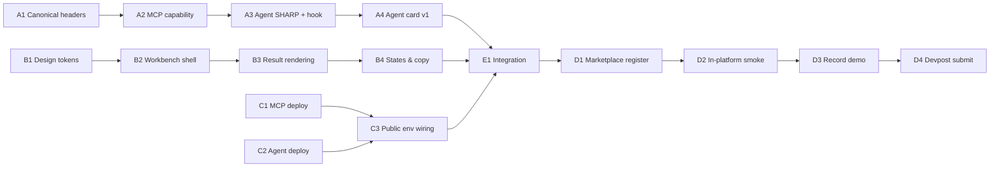

# feat: Ship MedAssist for Agents Assemble — SHARP correctness, UI rebuild, public deploy, demo

## Overview

MedAssist is the team's submission to Prompt Opinion's "Agents Assemble" hackathon (deadline 2026-05-11). The MCP server (6 clinical tools) and A2A agent (4 sub-agents) are functionally implemented and locally tested, but five gaps prevent submission: (1) SHARP context headers use a non-canonical naming scheme that the platform will not honor; (2) the MCP server does not advertise the required `ai.promptopinion/fhir-context` extension capability; (3) the A2A agent does not read FHIR context from A2A message metadata; (4) the agent card is on a deprecated schema; (5) the dashboard is uncommitted, visually inconsistent ("AI slop"), and nothing is publicly deployed for marketplace registration.

This plan ships a credible, standards-compliant submission tonight by running four parallel work tracks (A: backend correctness, B: frontend rebuild, C: public deploy, D: submission/demo) with explicit dependency lines between them.

## Problem Frame

Three distinct problems sit under one deadline:

1. **Standards compliance.** Cross-checking the codebase against the SHARP spec at `https://www.sharponmcp.com` and the reference implementations at `https://github.com/prompt-opinion/po-community-mcp` and `po-adk-python`, the team's headers (`x-sharp-patient-id`, `x-sharp-fhir-url`, `x-sharp-fhir-token`) do not match the canonical SHARP wire format (`X-Patient-ID`, `X-FHIR-Server-URL`, `X-FHIR-Access-Token`). The MCP server does not declare the `ai.promptopinion/fhir-context` extension in its `initialize` response. The A2A agent does not read FHIR context from message `metadata` keyed by `https://app.promptopinion.ai/schemas/a2a/v1/fhir-context`. Without these, Prompt Opinion will register the agent but no patient context will reach the tools.

2. **UI quality.** The current dashboard at `frontend/index.html` + `frontend/app.js` + `frontend/styles.css` (uncommitted, ~2,000 lines added) is visually generic — gradient orbs, rounded card stacks, three-color status grid, generic empty states. The user describes it as "AI slop." Submission demos ride on first impression; a rebuild with editorial-clinical character is required.

3. **Distribution.** Marketplace registration requires a publicly reachable agent-card URL and `/mcp` endpoint. Today both services run only on localhost. The demo video must show functionality *inside Prompt Opinion*, which is impossible without public URLs.

## Requirements Trace

- **R1.** MCP server exposes the canonical SHARP headers and `ai.promptopinion/fhir-context` capability so Prompt Opinion's launch propagates patient/FHIR context into tool calls.
- **R2.** A2A agent extracts FHIR context from A2A message metadata, sets it into session state, and forwards it as canonical SHARP headers when calling MCP tools.
- **R3.** Agent card conforms to A2A v1 schema (`supportedInterfaces[]`) and is served at `/.well-known/agent-card.json` from a publicly reachable URL.
- **R4.** The web app at `/app` looks intentional and clinical — not generic dashboard-template — and clearly demonstrates each tool to a judge.
- **R5.** MCP server and agent are deployed publicly with stable HTTPS URLs and reachable health endpoints.
- **R6.** The agent is registered in Prompt Opinion's External Agents UI and can be invoked from a workspace using a real (synthetic) patient.
- **R7.** A demo video under 3 minutes, showing operation *inside Prompt Opinion*, is recorded, hosted, and submitted on Devpost before 2026-05-11 23:00 ET.
- **R8.** No real PHI used at any point; only synthetic data from public HAPI sandbox or Synthea-derived patients.

## Scope Boundaries

- **Not in scope:** new clinical tools beyond the existing six; new sub-agents; CI/CD pipelines; production-grade auth (anonymous + header pass-through is the SHARP-acceptable minimum); rate limiting; multi-tenancy; observability beyond `/health`.
- **Not in scope:** loading a private FHIR server with our own Synthea-generated cohort. Public HAPI sandbox + 2–3 curated patient IDs is the demo strategy.
- **Not in scope:** restructuring the MCP tool source files. The tool implementations are correct; only the SHARP layer above them changes.

### Deferred to Separate Tasks

- Marketplace listing polish (icon, screenshots, long description) — handle right after the deploy lands, before demo recording.
- Replacing public HAPI with a managed FHIR server — post-submission improvement.

## Context & Research

### Relevant Code and Patterns

- `mcp-server/src/auth/sharp-context.ts` — current SHARP context resolver reading from `_meta` keys `patient_id`, `fhir_server_url`, `fhir_access_token`. Needs canonical HTTP header support added as primary path.
- `mcp-server/src/index.ts` — Express + StreamableHTTP transport. The `initialize` response is where capability advertisement must be added; current `server.ts` likely registers tools but not extensions.
- `mcp-server/src/server.ts` — MCP server construction; capabilities object should declare `ai.promptopinion/fhir-context`.
- `agent/medassist/sharp/context.py` — current header reader using `x-sharp-*` names. Replace with canonical SHARP names; add A2A metadata extraction path.
- `agent/medassist/sharp/middleware.py` — Starlette middleware setting context into ASGI scope and ContextVar. Mirrors `po-adk-python/shared/middleware.py`.
- `agent/medassist/agents/root_agent.py` — root agent with `McpToolset` configuration. The HTTP request to MCP must inject canonical SHARP headers from the resolved context.
- `agent/agent_card.json` — current agent card. Likely uses deprecated `url`/`preferredTransport`; replace with `supportedInterfaces[]` per A2A v1.
- `agent/medassist/main.py` — ASGI app composition (`to_a2a` from ADK). The `before_model_callback` hook for FHIR-context extraction goes near where the agent is bound to the A2A server.
- `frontend/index.html`, `frontend/app.js`, `frontend/styles.css` — current dashboard. Treat as discard; rebuild from a fresh design brief.
- `mcp-server/Dockerfile`, `agent/Dockerfile`, `docker-compose.yml` — present but not validated against Render or Cloud Run. Will need a `render.yaml` or service-specific tweaks.

### Institutional Learnings

No prior `docs/solutions/` artifacts apply. The repo's own `docs/project-status.md` overstates verification — most "verified locally" claims are import/build checks, not end-to-end runs. Do not trust the doc; trust outcomes.

### External References

- **SHARP spec:** `https://www.sharponmcp.com/overview.html`, `/key-components.html`, `/getting-started.html` — canonical header names, MCP capability shape, auth modes.
- **MCP-FHIR context docs:** `https://docs.promptopinion.ai/fhir-context/mcp-fhir-context` — the extension URI and SMART scopes the server must advertise.
- **A2A-FHIR context docs:** `https://docs.promptopinion.ai/fhir-context/a2a-fhir-context` — agent-card extension declaration and message-metadata payload shape.
- **A2A v1 migration:** `https://docs.promptopinion.ai/a2a-v1-migration` — `supportedInterfaces[]` replaces `url`/`preferredTransport`; `securitySchemes` typed-key shape.
- **Reference MCP server:** `https://github.com/prompt-opinion/po-community-mcp` — `typescript/index.ts` shows capability advertisement; `typescript/fhir-utilities.ts` shows header reading and JWT patient-claim fallback.
- **Reference A2A agent:** `https://github.com/prompt-opinion/po-adk-python` — `shared/middleware.py`, `shared/fhir_hook.py`, `shared/app_factory.py` (the `AgentCardV1` / `AgentExtensionV1` shim).
- **External Agents docs:** `https://docs.promptopinion.ai/agents/external-agents` — registration flow.
- **Public test endpoints:** `https://dotnet.fhir-mcp.promptopinion.ai/mcp`, `https://ts.fhir-mcp.promptopinion.ai/mcp` — useful for behavioral comparison.
- **Hackathon rules:** `https://agents-assemble.devpost.com/rules` — synthetic-data-only requirement; <3min video; in-platform demo.

## Key Technical Decisions

- **Canonical SHARP headers are primary; `_meta` is fallback.** Rename header reads to `X-Patient-ID`, `X-FHIR-Server-URL`, `X-FHIR-Access-Token` (case-insensitive). Keep the existing `_meta` JSON-RPC reader as a secondary path so the dashboard's direct REST calls (which inject context via `_meta`) keep working without rework. **Why:** the SHARP spec and reference implementations canonicalize headers; `_meta` is a permitted but non-primary transport. The dashboard's body-based context injection is internal-only and can be migrated later.
- **MCP capability declaration uses fixed scopes.** Advertise `patient/Patient.rs` (required), `patient/Observation.rs`, `patient/Condition.rs`, `patient/MedicationStatement.rs`, `patient/AllergyIntolerance.rs`, `patient/Immunization.rs`, plus `offline_access`. **Why:** these match exactly what the six tools query. Over-requesting risks Prompt Opinion rejecting the registration; under-requesting silently breaks tools.
- **A2A FHIR context uses `before_model_callback`.** Mirror `po-adk-python/shared/fhir_hook.py` exactly. Read `metadata["https://app.promptopinion.ai/schemas/a2a/v1/fhir-context"]` from the incoming A2A request, write it into ADK session state, and have the `McpToolset` HTTP client read from session state to inject canonical SHARP headers on every MCP call. **Why:** session-state propagation is the ADK-native pattern; ad-hoc threading of context through `RunContext` would break sub-agent fan-out.
- **Agent card v1 with shim classes.** Copy `AgentCardV1` and `AgentExtensionV1` from `po-adk-python/shared/app_factory.py` verbatim. Declare `https://app.promptopinion.ai/schemas/a2a/v1/fhir-context` as an extension. Set `capabilities.stateTransitionHistory: false`. Keep all four skills (patient_review, medication_safety, risk_assessment, preventive_care). **Why:** the upstream `a2a-sdk` Python lib lags v1; the shim is the working pattern in production references.
- **Frontend is rebuilt, not patched.** The current dashboard's design language is generic and the markup carries patterns that resist surgical fixes (gradient orbs, three-card status grid, "command center" hero). A clean rebuild with an editorial-clinical aesthetic is faster than a redesign-in-place. **Why:** when the user calls something "AI slop," the underlying issue is design language; patching adds cost without fixing the perception.
- **Editorial-clinical design language.** Single primary surface, generous whitespace, real typographic hierarchy (one display serif, one neutral sans, one mono), high-contrast monochrome with one anchor accent (deep ink + warm bone + a single saturated alert color), no gradient blobs or animated atmosphere, results render as a clinical note with proper measure (~70ch), not as Markdown-styled cards. Loading/empty/error states use specific clinical-context copy ("Pulling Observation entries since 2025-04-27"), not vague spinners. **Why:** AI-slop is the absence of considered choices; one anchor decision per axis (one serif, one accent, one surface at a time) is what reads as intentional.
- **Render over Cloud Run for tonight.** Both Dockerfiles already exist; Render auto-detects them, gives free public HTTPS in minutes, and needs no GCP project setup. **Why:** time-to-deploy is the only metric that matters tonight. Cloud Run remains the long-term option.
- **Demo data: public HAPI + curated patient IDs.** Use `https://hapi.fhir.org/baseR4` with three pre-validated patient IDs that have conditions, medications, observations, and allergies populated. Document them in `docs/test-scenarios.md`. **Why:** loading Synthea into a private FHIR server tonight has too many unknowns (server choice, cohort generation, network reliability). HAPI sandbox is volatile but acceptable for one demo recording window.
- **Parallel-agent execution.** Tracks A (backend), B (frontend), C (deploy) run concurrently in worktrees so changes don't collide. Track D (submission) is serial after A+B+C land. The integration verification (Unit E1) is the join point. **Why:** each track touches disjoint file sets — `mcp-server/src/auth` + `agent/medassist/sharp` for A, `frontend/*` for B, root-level `render.yaml` + Dockerfiles for C — so a worktree-per-track avoids merge churn while letting all three race the clock.

## Open Questions

### Resolved During Planning

- **Headers vs `_meta` for SHARP context:** Headers are primary per the spec; `_meta` is kept as fallback for the in-app dashboard's REST calls.
- **Which deploy provider:** Render, for time-to-deploy.
- **Agent-card schema:** A2A v1 with shim classes from the reference repo.
- **Demo data source:** Public HAPI sandbox + curated patient IDs.
- **UI strategy:** Rebuild, not patch.

### Deferred to Implementation

- **Exact patient IDs that have rich data on HAPI today** — confirm at integration time (Unit E1) by running each tool against three candidates and picking the best.
- **Whether Render's free tier sleeps the agent service between requests, breaking Prompt Opinion's first-call timeout** — measure during Unit C2; if it does, switch agent to a paid Render instance type or to Fly.io.
- **Final color palette and typeface choice for the rebuild** — picked during Unit B1 design brief.
- **Whether the `McpToolset` HTTP client needs subclassing or a header-injection middleware** — discovered during Unit A3 implementation depending on ADK's extension points.

## Output Structure

```
docs/plans/
  2026-04-27-001-feat-ship-medassist-agents-assemble-plan.md  # this file
docs/
  promptopinion-submission.md  # NEW: registration steps + URLs (Unit D1)
mcp-server/
  src/auth/sharp-context.ts                  # MODIFIED: canonical headers (Unit A1)
  src/server.ts                              # MODIFIED: capability advertisement (Unit A2)
  tests/sharp-context.test.ts                # MODIFIED: canonical-header coverage
agent/
  medassist/
    sharp/context.py                         # MODIFIED: canonical headers (Unit A3)
    sharp/middleware.py                      # MODIFIED: A2A metadata path (Unit A3)
    sharp/fhir_hook.py                       # NEW: before_model_callback (Unit A3)
    a2a/agent_card.py                        # NEW: AgentCardV1 shim (Unit A4)
    main.py                                  # MODIFIED: bind shim, serve v1 card (Unit A4)
  agent_card.json                            # MODIFIED: v1 schema (Unit A4)
  tests/test_sharp_context.py                # MODIFIED: canonical-header coverage
  tests/test_agent_card.py                   # NEW: v1 schema assertions (Unit A4)
frontend/
  index.html                                 # REWRITTEN (Unit B2)
  app.js                                     # REWRITTEN (Unit B2, B3)
  styles.css                                 # REWRITTEN (Unit B1)
  design-tokens.css                          # NEW: typography/color/spacing primitives (Unit B1)
render.yaml                                  # NEW: two-service definition (Unit C1, C2)
.env.production.example                      # NEW: deploy env template (Unit C3)
README.md                                    # MODIFIED: deploy + demo links (Unit D4)
```

## High-Level Technical Design

> *This illustrates the intended approach and is directional guidance for review, not implementation specification. The implementing agent should treat it as context, not code to reproduce.*



The two correctness gates are: (1) Prompt Opinion's launch must produce A2A `metadata` with the FHIR-context extension URI, which the agent then converts into canonical SHARP headers; (2) the MCP server must advertise that it accepts the `ai.promptopinion/fhir-context` extension so the platform considers it a valid endpoint to route.

## Implementation Units

The plan runs in five tracks. **Tracks A, B, and C run in parallel** (each in its own git worktree). **Track D is serial** after the first three converge at Unit E1.



---

### Track A — Backend correctness

- [ ] **Unit A1: Switch MCP server to canonical SHARP headers**

**Goal:** MCP server reads patient/FHIR context from canonical SHARP HTTP headers (case-insensitive), with `_meta` retained as fallback.

**Requirements:** R1.

**Dependencies:** None.

**Files:**
- Modify: `mcp-server/src/auth/sharp-context.ts`
- Modify: `mcp-server/src/server.ts` (header read site if context resolution lives there)
- Modify: `mcp-server/src/index.ts` (Express middleware that parses request before MCP transport)
- Test: `mcp-server/tests/sharp-context.test.ts`

**Approach:**
- Add a header reader that checks (case-insensitive) `X-Patient-ID`, `X-FHIR-Server-URL`, `X-FHIR-Access-Token`, plus optional `X-FHIR-Refresh-Token`, `X-FHIR-Refresh-Url`.
- Resolution order per request: canonical headers first; if all missing, fall back to existing `_meta` keys.
- If a JWT is present in `X-FHIR-Access-Token`, attempt to extract the `patient` claim and prefer it over `X-Patient-ID`, matching reference behavior.
- Surface the resolved context the same way the codebase does today so tools don't need changes.

**Patterns to follow:**
- Reference: `po-community-mcp/typescript/fhir-utilities.ts` JWT-claim and header-precedence logic.

**Test scenarios:**
- Happy path — request with all three canonical headers populates context with matching values.
- Happy path — case-insensitive header names (`x-patient-id` lowercase) resolve.
- Edge case — only `X-FHIR-Access-Token` with a valid JWT containing a `patient` claim resolves patient ID without `X-Patient-ID`.
- Edge case — JWT `patient` claim takes precedence over `X-Patient-ID` when both present.
- Edge case — request with no canonical headers but legacy `_meta` keys still resolves (fallback).
- Error path — request with neither headers nor `_meta` returns an empty context (not an exception).
- Integration — a tool invocation through the full Express → MCP transport pipeline sees the resolved context.

**Verification:**
- All `sharp-context` tests pass.
- A curl against `/mcp` with canonical headers reaches a tool whose response reflects the supplied patient ID.

---

- [ ] **Unit A2: Declare `ai.promptopinion/fhir-context` MCP capability**

**Goal:** MCP server advertises the FHIR-context extension and required SMART scopes in its `initialize` response.

**Requirements:** R1.

**Dependencies:** A1.

**Files:**
- Modify: `mcp-server/src/server.ts`
- Test: `mcp-server/tests/server-capabilities.test.ts` (NEW)

**Approach:**
- Extend the MCP server construction to include `capabilities.extensions["ai.promptopinion/fhir-context"]` with a scopes array.
- Required scope: `patient/Patient.rs`. Optional scopes covering the six tools: `patient/Observation.rs`, `patient/Condition.rs`, `patient/MedicationStatement.rs`, `patient/AllergyIntolerance.rs`, `patient/Immunization.rs`, plus `offline_access`.
- Decide whether `fhir_context_required` is `true` or `false`; choose `false` so the dashboard's local mode (no headers) still works, and rely on tool-level guards to refuse when patient ID is missing.

**Patterns to follow:**
- Reference: `po-community-mcp/typescript/index.ts` capability declaration.

**Test scenarios:**
- Happy path — MCP `initialize` response contains the extension URI and the full scopes list.
- Happy path — `patient/Patient.rs` scope is marked required.
- Edge case — `fhir_context_required.value` is `false` so an unauthenticated `initialize` succeeds.

**Verification:**
- A handshake against `/mcp` returns a capabilities object containing the extension declaration.

---

- [ ] **Unit A3: Update agent SHARP middleware + add A2A FHIR-context hook**

**Goal:** Agent reads FHIR context from A2A message metadata, sets it into session state, and forwards canonical SHARP headers when calling MCP tools.

**Requirements:** R1, R2.

**Dependencies:** A1, A2.

**Files:**
- Modify: `agent/medassist/sharp/context.py` (rename headers to canonical)
- Modify: `agent/medassist/sharp/middleware.py` (still extract from incoming HTTP headers as a secondary path for direct calls)
- Create: `agent/medassist/sharp/fhir_hook.py` (`before_model_callback` that reads A2A message metadata)
- Modify: `agent/medassist/agents/root_agent.py` (install hook; ensure `McpToolset` HTTP client injects canonical headers from session state)
- Modify: `agent/medassist/main.py` (bind hook to root agent at A2A app composition)
- Test: `agent/tests/test_sharp_context.py` (rename headers in fixtures)
- Test: `agent/tests/test_fhir_hook.py` (NEW)

**Approach:**
- Rename context fields' source headers to `X-Patient-ID` / `X-FHIR-Server-URL` / `X-FHIR-Access-Token` (case-insensitive read).
- Add `before_model_callback` that checks the inbound A2A message's `metadata` dict for the FHIR-context extension URI; on hit, write `fhirUrl`, `fhirToken`, `patientId` into ADK session state.
- Configure the `McpToolset`'s HTTP transport to read from session state and inject canonical SHARP headers on every outbound MCP call. If ADK's exposed extension points don't allow this directly, wrap the HTTP client in a thin custom layer.

**Execution note:** Test-first for the hook — write a failing test that asserts session state is populated when an A2A request arrives with the extension metadata.

**Patterns to follow:**
- Reference: `po-adk-python/shared/middleware.py`, `shared/fhir_hook.py`.
- Existing pattern: `agent/medassist/sharp/context.py` data class and resolution.

**Test scenarios:**
- Happy path — A2A request with `metadata[<fhir-context-uri>] = {fhirUrl, fhirToken, patientId}` populates session state with all three values.
- Happy path — agent invokes an MCP tool and the outbound HTTP request carries `X-Patient-ID`, `X-FHIR-Server-URL`, `X-FHIR-Access-Token` matching session state.
- Edge case — A2A request without the extension metadata leaves session state empty and the MCP call carries no SHARP headers.
- Edge case — partial metadata (only `patientId`) still populates that field, others remain unset.
- Error path — malformed metadata (non-dict, missing keys) is logged and ignored, not raised.
- Integration — direct HTTP call to the agent's `/health` does not require FHIR context; the hook only activates on A2A messages.

**Verification:**
- Hook unit tests pass.
- An end-to-end curl chain (mock A2A request → agent → MCP) shows headers carrying through.

---

- [ ] **Unit A4: Upgrade agent card to A2A v1**

**Goal:** Agent card declares `supportedInterfaces[]`, the FHIR-context extension, and v1-compliant security schemes.

**Requirements:** R3.

**Dependencies:** A3.

**Files:**
- Create: `agent/medassist/a2a/agent_card.py` (`AgentCardV1`, `AgentExtensionV1` shim mirrored from reference)
- Modify: `agent/medassist/main.py` (build card via shim; serve at `/.well-known/agent-card.json`)
- Modify: `agent/agent_card.json` (regenerated/handwritten v1 form)
- Test: `agent/tests/test_agent_card.py` (NEW or extend existing)

**Approach:**
- Copy the `AgentCardV1` and `AgentExtensionV1` shim from `po-adk-python/shared/app_factory.py` verbatim into `medassist/a2a/agent_card.py`.
- Construct the card with `supportedInterfaces[]` (entry: A2A protocol binding, current public URL, version), all four skills (patient_review, medication_safety, risk_assessment, preventive_care), `capabilities.stateTransitionHistory: false`, and the FHIR-context extension under `capabilities.extensions[]`.
- Use the v1 typed-key shape for `securitySchemes` (no auth required for hackathon, but the schema needs to be valid).
- The endpoint serves the card directly from the constructed object; remove drift between the static `agent_card.json` and the served version (or generate the static file from the shim at build time).

**Patterns to follow:**
- Reference: `po-adk-python/shared/app_factory.py`.

**Test scenarios:**
- Happy path — `/.well-known/agent-card.json` returns a JSON body with `supportedInterfaces` populated and no top-level `url` or `preferredTransport`.
- Happy path — card lists exactly four skills with the expected IDs.
- Happy path — card declares the FHIR-context extension URI under `capabilities.extensions`.
- Edge case — `capabilities.stateTransitionHistory` is `false`.
- Edge case — `supportedInterfaces[0].url` matches `AGENT_PUBLIC_URL` env var when set.

**Verification:**
- Schema-shape tests pass.
- `curl -s $AGENT_PUBLIC_URL/.well-known/agent-card.json | jq .` shows v1 structure.

---

### Track B — Frontend rebuild (anti-AI-slop)

- [ ] **Unit B1: Design tokens and primitives**

**Goal:** Establish the design language as a small, opinionated tokens file. Every later unit composes from these tokens, eliminating ad-hoc styling.

**Requirements:** R4.

**Dependencies:** None.

**Files:**
- Create: `frontend/design-tokens.css`
- Modify: `frontend/styles.css` (rebuilt; imports tokens)

**Approach:**
- One display serif (e.g., Source Serif 4 or system serif), one neutral sans (Inter or system), one mono (JetBrains Mono or system mono). Not three of each.
- Color: deep ink (#1A1814), warm bone (#F4EFE6), one anchor accent (single saturated color, e.g., a clinical crimson #B23A48 or a research-archive ochre #B8862F — pick one), plus restrained neutrals. No teal/sand/rose triplet. No gradient orbs.
- Spacing: a single 4px-based scale used consistently; generous outer margins (≥80px on desktop) so the workbench doesn't feel "command-center."
- Typography scale: large display (clamp ~36–56px), section (~20px), body (~16/24), small (~13/20), mono for IDs and timing. Real measure (~70ch) for prose results.
- No drop shadows, no rounded "cards floating on bg" pattern. Use rules and whitespace for separation.
- Define motion tokens: 80ms / 200ms / 360ms; reserve only the fastest for state changes, longest only for one signature transition (e.g., result reveal).

**Patterns to follow:**
- Reference reading the team can absorb in 5 minutes: editorial sites like Stripe Press, Werner Herzog Reads, NYT Magazine longforms — typographic hierarchy, calm color, intentional whitespace.

**Test scenarios:**
- Test expectation: none — pure design-token file. Verified visually via Unit B2 build.

**Verification:**
- A static demo page importing only the tokens shows the type scale, color set, and spacing rhythm in isolation.
- The sketch reviewed and approved before building Unit B2.

---

- [ ] **Unit B2: Single-surface clinical workbench shell**

**Goal:** Replace the current "command center" with a single primary surface — one panel at a time, not eight stacked cards.

**Requirements:** R4.

**Dependencies:** B1.

**Files:**
- Modify: `frontend/index.html` (rewritten markup)
- Modify: `frontend/app.js` (state machine; tool-selection, patient-staging, run lifecycle)

**Approach:**
- Layout: a fixed slim left rail (tool list with hover/active states only — no descriptions cluttering the rail), a wide central surface that mode-switches between `idle / configure / running / result / error`, a small persistent header strip (patient context + minimal status indicator), and an unobtrusive footer with the run history accessible behind a single click rather than always visible.
- No background animation. No pulsing orbs. The page should feel still and considered.
- Status indicator: a single dot + word ("Live" / "Degraded" / "Down") that opens a small detail popover on click. Never three side-by-side cards.
- Tool selection updates the central surface to a configure view scoped to that tool's required inputs only — no preview JSON dump unless explicitly requested.
- Replace "Stage Patient" / "Demo Runways" / "Invocation Preview" / "Stage Panel" / "History Panel" multi-panel approach with a single linear flow: pick patient → pick tool → configure → run → read result.
- Keep scenario presets but as a discreet "Try a scenario" link in the header that cycles through 2–3 presets, not five colorful cards.

**Patterns to follow:**
- Avoid: anything in current `frontend/index.html` lines 14–286.
- Borrow: the markup discipline of the team's tools' Markdown output — clear hierarchy, named sections, no decorative noise.

**Test scenarios:**
- Happy path — selecting a tool from the rail updates the central surface to the matching configure view; no other tool's inputs are visible.
- Happy path — clicking Run while a tool is configured transitions surface to running, then to result on response, with one motion transition (~360ms) and not several.
- Edge case — switching tools mid-result preserves the prior result in history but clears the surface to configure for the new tool.
- Error path — a network failure transitions surface to error with specific copy ("MCP server didn't respond after 8s — see status indicator") and a single Retry action.
- Integration — patient context set in the header is visible across all tool configure views without re-entry.

**Verification:**
- Manual browser walkthrough of all six tools in idle → result flow on Chrome and Safari.
- Lighthouse a11y score ≥ 90.

---

- [ ] **Unit B3: Clinical-note result rendering**

**Goal:** Markdown tool results render as a clinical note — typographic prose with proper measure — not as styled JSON cards.

**Requirements:** R4.

**Dependencies:** B1, B2.

**Files:**
- Modify: `frontend/app.js` (Markdown renderer)
- Modify: `frontend/styles.css` (note styles)

**Approach:**
- Reuse the existing custom Markdown renderer logic but restyle output: serif body, ~70ch measure, real `h2/h3` hierarchy, minimal list adornment, tables that look like clinical reference tables (rules between rows, small caps headers), code/IDs in mono with a subtle inline tint.
- Add a "copy as note" action (single button, no toolbar) that copies the rendered text in plain or Markdown form depending on a saved preference.
- Render runtime + tool name + timestamp as a small caption at the top, not as a status card.
- Handle heavy tables (lab interpretations) and nested lists (care gaps) — verify each of the six tools renders cleanly.

**Test scenarios:**
- Happy path — a Markdown body with `# / ## / ### / table / list / code / blockquote` renders without unstyled fallback.
- Happy path — copy action places the right text on the clipboard (Markdown form by default).
- Edge case — empty result renders the empty state, not an empty note frame.
- Edge case — very long results scroll inside the surface without breaking the rail or header.
- Error path — malformed Markdown (unclosed code fence) doesn't crash the renderer; it renders best-effort with a small "rendering hint" footer.
- Integration — output of each of the six MCP tools, run live against the public HAPI sandbox, renders without visual breakage.

**Verification:**
- All six tool outputs reviewed in browser and look like documents, not dashboards.

---

- [ ] **Unit B4: States and copy**

**Goal:** Loading, empty, and error states are part of the design — specific, useful, and tonally consistent.

**Requirements:** R4.

**Dependencies:** B2, B3.

**Files:**
- Modify: `frontend/app.js` (state copy + transitions)
- Modify: `frontend/styles.css` (state styles)

**Approach:**
- Loading copy is specific to the current tool ("Pulling Observation entries since 2025-04-27", "Checking RxNorm for interactions", not "Interpreting clinical context").
- Empty state for the result surface invites action: a one-line description of what the user just selected and what will happen on Run.
- Empty state for history: a single sentence and the link to scenarios.
- Error state shows: the action that failed, the system that failed, what the user can do (retry, change patient, check status). No stack traces; no "Analysis halted."
- Status indicator detail popover gives one diagnostic line per service: MCP/agent/FHIR, version, last successful call timestamp.
- All copy reviewed for tone: clinical, plain, second-person, no exclamation points, no emoji.

**Test scenarios:**
- Happy path — loading copy varies per tool.
- Happy path — error state for a 500 from MCP shows the system name and a Retry action.
- Edge case — network offline shows a distinct state from server-error.
- Edge case — FHIR returns no patients matching the supplied ID; result is an empty state, not an error.
- Integration — every error path actually reachable from the UI has a defined state and copy.

**Verification:**
- Manually trigger each state (devtools network throttling, kill MCP, invalid patient ID) and confirm tone and specificity.

---

### Track C — Public deploy

- [ ] **Unit C1: MCP server public deploy**

**Goal:** MCP server is reachable at a public HTTPS URL with a green `/health`.

**Requirements:** R5.

**Dependencies:** A2 (so the deployed server already advertises the capability).

**Files:**
- Create: `render.yaml` (two-service definition; this unit fills in the MCP service)
- Modify: `mcp-server/Dockerfile` (only if Render's autodetect requires tweaks — confirm during implementation)

**Approach:**
- Define a Render web service for `mcp-server`, Docker runtime, port 3001 (or Render's `$PORT`), env vars: `FHIR_BASE_URL=https://hapi.fhir.org/baseR4`, `OPENFDA_API_KEY` (optional), no auth required.
- Confirm the existing Dockerfile builds in Render's environment; if it relies on `npm run build` then `npm run start`, set those as build/start commands.
- Public hostname becomes `MCP_SERVER_URL` for Track A wiring.

**Test scenarios:**
- Happy path — `GET <public-mcp>/health` returns 200.
- Happy path — `POST <public-mcp>/mcp` with an `initialize` request returns the v1 capability declaration including the FHIR-context extension.
- Edge case — service cold-start latency measured; if >10s, escalate to a paid tier or a different host.

**Verification:**
- `curl` against the public URL succeeds for both health and a tool invocation with a known HAPI patient ID.

---

- [ ] **Unit C2: Agent public deploy**

**Goal:** Agent is reachable at a public HTTPS URL with a green `/health` and a v1 agent card at `/.well-known/agent-card.json`.

**Requirements:** R5.

**Dependencies:** A4 (so the deployed agent serves the v1 card).

**Files:**
- Modify: `render.yaml` (add the agent service)
- Modify: `agent/Dockerfile` (only if Render's autodetect requires tweaks)

**Approach:**
- Render web service for `agent`, Docker runtime, env vars: `MCP_SERVER_URL=<public mcp url>`, `AGENT_PUBLIC_URL=<this service's url>`, `GOOGLE_API_KEY=<from secrets>`, `AGENT_PORT=$PORT`.
- Verify free tier doesn't sleep (sleeps would break Prompt Opinion's first call); if it does, upgrade or move to Fly.io.

**Test scenarios:**
- Happy path — `GET <public-agent>/.well-known/agent-card.json` returns v1 schema.
- Happy path — `GET <public-agent>/health` returns 200 and reports MCP reachable.
- Edge case — first request after idle responds within 10s.

**Verification:**
- Card validates against the v1 shape; health reports MCP green.

---

- [ ] **Unit C3: Public env wiring**

**Goal:** Configuration paths are clear and reproducible: which env vars must be set in which environment.

**Requirements:** R5.

**Dependencies:** C1, C2.

**Files:**
- Create: `.env.production.example`
- Modify: `README.md` (deploy section pointing to the new file and Render flow)
- Modify: `docs/startup.md` (add Render path alongside local)

**Approach:**
- `.env.production.example` lists `MCP_SERVER_URL`, `AGENT_PUBLIC_URL`, `GOOGLE_API_KEY`, `FHIR_BASE_URL`, `OPENFDA_API_KEY` (optional), and notes which are set in Render dashboard vs which are static.
- README gains a four-step "Deploy to Render" section linking to the example file.

**Test scenarios:**
- Test expectation: none — config and docs only.

**Verification:**
- Reading the README cold, a teammate could redeploy from a fresh clone in <15 minutes.

---

### Track D — Submission

- [ ] **Unit D1: Register in Prompt Opinion marketplace**

**Goal:** The deployed agent appears in a Prompt Opinion workspace as an External Agent.

**Requirements:** R6.

**Dependencies:** E1.

**Files:**
- Create: `docs/promptopinion-submission.md` (registration steps, screenshots, URLs)

**Approach:**
- Sign in at `app.promptopinion.ai`. Navigate **Agents → External Agents → Add Connection**. Paste `<AGENT_PUBLIC_URL>/.well-known/agent-card.json`.
- Confirm platform parses card and lists all four skills.
- Document the result in `docs/promptopinion-submission.md` including: registration URL, skills list as parsed by the platform, and a screenshot of the registered agent.

**Test scenarios:**
- Happy path — agent appears in workspace registry after URL submission.
- Edge case — if registration fails, capture the platform error and reach out via Discord (`https://discord.gg/JS2bZVruUg`) before iterating.

**Verification:**
- Screenshot of agent visible in a Prompt Opinion workspace.

---

- [ ] **Unit D2: In-platform smoke test**

**Goal:** The agent, invoked from inside a Prompt Opinion workspace with a real (synthetic) patient, returns a real result for at least three of the four sub-agent skills.

**Requirements:** R6, R8.

**Dependencies:** D1.

**Files:**
- Modify: `docs/promptopinion-submission.md` (record outcomes per skill)

**Approach:**
- Inside Prompt Opinion, attach a workspace to the public HAPI sandbox using the curated patient IDs.
- Invoke patient_review, medication_safety, risk_assessment, preventive_care in turn. Capture screenshots and timings.
- Record any failures with platform-side error messages.

**Test scenarios:**
- Happy path — at least three skills return a non-empty clinical result.
- Edge case — first call after deploy may be slow; record but don't gate on it.
- Error path — if any skill fails, triage: platform error vs SHARP wiring vs FHIR data.

**Verification:**
- Three working skills with screenshots in `docs/promptopinion-submission.md`.

---

- [ ] **Unit D3: Record demo video**

**Goal:** A <3-minute video, hosted on YouTube as unlisted, showing MedAssist invoked from a Prompt Opinion workspace.

**Requirements:** R7.

**Dependencies:** D2.

**Files:**
- Modify: `README.md` (add video link)
- Modify: `docs/demo-script.md` (final cut version of the script)

**Approach:**
- Use the existing `docs/demo-script.md` as a starting point, trimmed to fit 2:30.
- Beats: 0:00 frame the problem (clinician burnout, fragmented data) → 0:20 introduce MedAssist as an A2A agent in Prompt Opinion → 0:40 invoke patient_review skill, show clinical-note result render → 1:20 invoke medication_safety, show interaction list → 2:00 invoke risk_assessment for CHA2DS2-VASc → 2:30 close with "open standards, MCP + A2A + SHARP" call-out.
- Record using OBS or QuickTime; export as 1080p; upload as unlisted YouTube; add link to README.

**Test scenarios:**
- Happy path — final video is under 3:00, audio clean, all on-screen text legible.
- Edge case — if the platform UI changes between record and submit, re-record.

**Verification:**
- Watching the video, a judge could reproduce the workflow.

---

- [ ] **Unit D4: Devpost submission**

**Goal:** The submission is filed on Devpost with all required artifacts.

**Requirements:** R7.

**Dependencies:** D3.

**Files:**
- Modify: `README.md` (final feature description, submission link)

**Approach:**
- Go to `https://agents-assemble.devpost.com/`, file submission with: project name, short description, full feature description (lifted from README), video link, GitHub repo URL, marketplace agent URL.
- Confirm submission timestamp is before 2026-05-11 23:00 ET.

**Test scenarios:**
- Test expectation: none — administrative.

**Verification:**
- Devpost confirmation email received.

---

### Track E — Integration join

- [ ] **Unit E1: End-to-end integration verification**

**Goal:** Exercise the full chain (browser → public agent → public MCP → HAPI) with the curated patient IDs and confirm correctness.

**Requirements:** R1–R5, R8.

**Dependencies:** A4, B4, C3.

**Files:**
- Modify: `scripts/smoke-test.sh` (extend to hit public URLs, not just localhost)
- Modify: `docs/test-scenarios.md` (record the three curated patient IDs that pass)

**Approach:**
- From a local machine, send an A2A request to the deployed agent containing the FHIR-context extension metadata.
- Verify in agent logs that the hook fires and session state is populated.
- Verify in MCP logs that incoming HTTP requests carry canonical SHARP headers.
- Verify each of the six tools returns non-empty results for at least one curated patient.
- Pick the three best patient IDs (richest data, fastest response) and freeze them in `docs/test-scenarios.md`.

**Test scenarios:**
- Happy path — all six tools return non-empty Markdown for at least one patient.
- Edge case — one patient has no allergies; the patient_summary tool renders an empty allergies section gracefully.
- Error path — invalid patient ID; tool returns a clear "patient not found" message; UI shows the empty state, not a crash.
- Integration — frontend at `<MCP_SERVER_URL>/app` performs the full flow against deployed services and renders results.

**Verification:**
- Smoke script exits 0 against public URLs.
- Three curated patient IDs documented and demonstrably exercise every tool.

---

## System-Wide Impact

- **Interaction graph:** SHARP context now flows through three layers (A2A metadata → ADK session state → MCP HTTP headers); any change in one of those layers must update the others. The `before_model_callback` is a new entry point for sub-agent fan-out — verify each sub-agent inherits session state.
- **Error propagation:** SHARP context absence used to silently produce empty tool results. With canonical headers in place, the MCP server can choose to 403 when `fhir_context_required.value === true`; we keep it `false` for the dashboard's local mode but tools should still emit a clear "patient ID required" message rather than degrading to empty data.
- **State lifecycle risks:** Session state in ADK is per-conversation; a long-running multi-turn conversation must not leak FHIR tokens across patients. Verify the hook resets state when a new A2A `metadata` block arrives.
- **API surface parity:** The dashboard at `/app` calls REST endpoints (`/api/patient-summary` etc.), not `/mcp`. Those REST endpoints must also resolve SHARP context (currently via `_meta` body keys). Keep that path working — Unit A1's fallback handles this.
- **Integration coverage:** Unit-level tests don't prove the hook fires when ADK runs a real A2A request; Unit E1 is the only place that proves end-to-end propagation.
- **Unchanged invariants:** The six tool implementations under `mcp-server/src/tools/` are untouched. The four sub-agent definitions under `agent/medassist/agents/` are untouched. The FHIR client under `mcp-server/src/fhir/` is untouched. Test counts (161 MCP, 34 agent) should grow, never shrink.

## Risks & Dependencies

| Risk | Mitigation |
|------|------------|
| Render free tier sleeps the agent service, breaking Prompt Opinion's first-call timeout. | Measure during Unit C2; upgrade to a paid Render plan or move to Fly.io if confirmed. Single env-var swap. |
| `McpToolset` HTTP client doesn't expose a clean way to inject per-call headers. | If true, wrap the toolset's HTTP transport or set headers via session-state-aware connection params; fallback is a thin custom HTTP client used only for the MCP call path. Discovered in Unit A3; estimated +1h. |
| Public HAPI sandbox is rate-limited or down during demo recording. | Curated patient IDs documented; have a local FHIR server (HAPI in Docker) as fallback for the recording session; record at off-peak hours. |
| Prompt Opinion registration UI rejects the agent card despite v1 schema. | Reach out via hackathon Discord (`https://discord.gg/JS2bZVruUg`) immediately with the failing card; have the dotnet/ts reference cards as schema diff sources. |
| Markdown rendering edge cases break with real tool output (nested tables, code in lists). | Unit B3 verifies all six tools' real output; bugs found there are time-boxed to 30 min before falling back to a vetted library renderer. |
| The "AI slop" rebuild starts well but rabbit-holes on color/typography. | Tokens locked in Unit B1 before any markup; hard time-box of 90 min on B1; if not done, accept the current tokens and move on to B2. |
| Synthetic-data-only rule violation from accidentally pointing at a real FHIR server. | All deploy env templates and READMEs hardcode `https://hapi.fhir.org/baseR4` as the only sanctioned FHIR URL; prod env review checklist before deploy. |
| Hard deadline (May 11, 23:00 ET) leaves no slip room if Track A or C blocks. | Plan completes core submission tonight, leaves 13 days for iteration; `compound-engineering:research:slack-researcher` skipped only because we have no internal Slack to consult — use Discord instead if blocked. |

## Documentation / Operational Notes

- After Unit D4 lands, mark `docs/project-status.md` honestly: which "verified locally" claims have now been verified end-to-end, which remain limited to local.
- The marketplace listing's long description should mirror the README's first three paragraphs; keep them in sync until submission.
- Post-submission, capture learnings (especially around `McpToolset` header injection and Render deployment quirks) in `docs/solutions/` so future Prompt Opinion submissions move faster.

## Sources & References

- **Audit reports** (in-conversation, 2026-04-27): codebase-and-UI audit + Prompt Opinion + SHARP research, both produced via parallel sub-agents prior to this plan.
- **SHARP spec:** `https://www.sharponmcp.com/`
- **Prompt Opinion docs:** `https://docs.promptopinion.ai/` — particularly `/fhir-context/mcp-fhir-context`, `/fhir-context/a2a-fhir-context`, `/a2a-v1-migration`, `/agents/external-agents`.
- **Reference repos:** `https://github.com/prompt-opinion/po-community-mcp`, `https://github.com/prompt-opinion/po-adk-python`.
- **Hackathon resources:** `https://agents-assemble.devpost.com/`, `https://agents-assemble.devpost.com/rules`, `https://agents-assemble.devpost.com/resources`.
- **Discord (hackathon):** `https://discord.gg/JS2bZVruUg`.
- **Getting Started video:** `https://youtu.be/Qvs_QK4meHc`.
- **Local docs:** `docs/project-status.md`, `docs/demo-script.md`, `docs/test-scenarios.md`.
